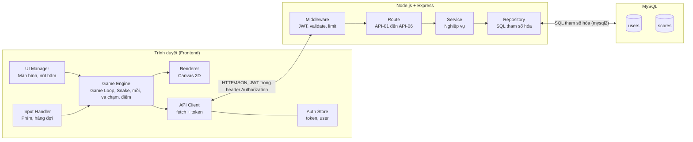
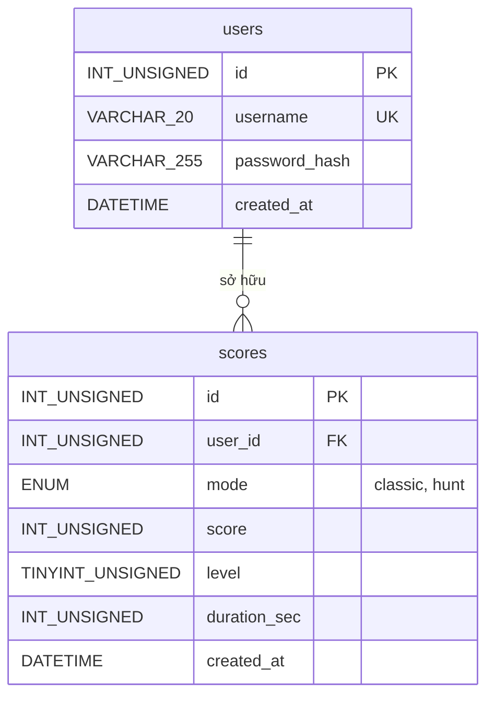
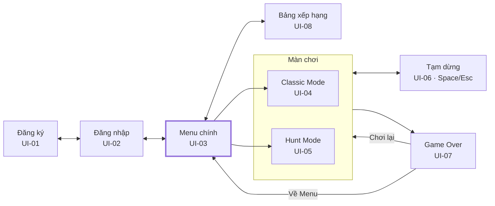
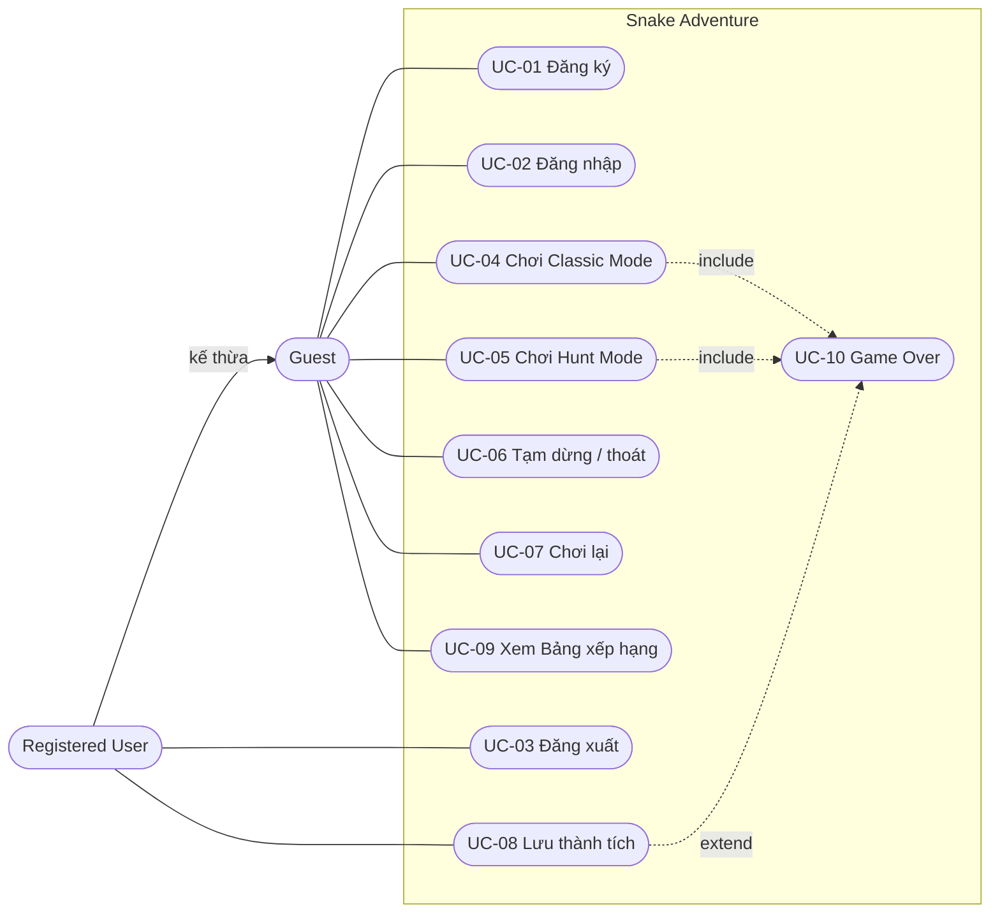
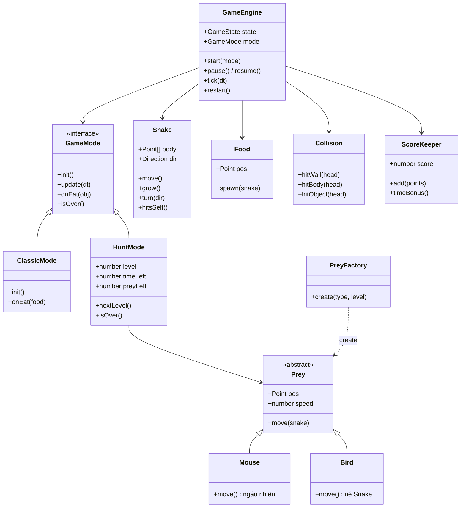
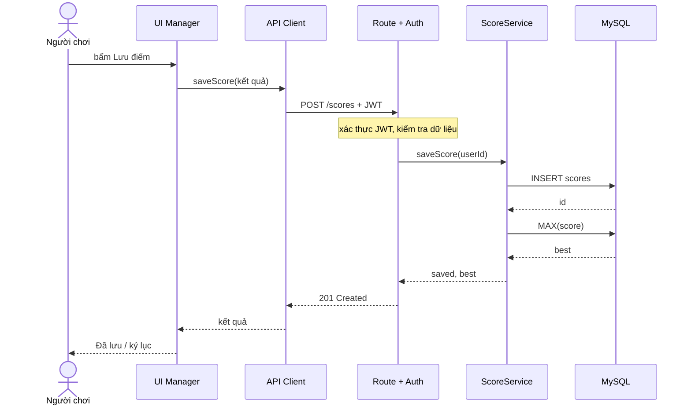
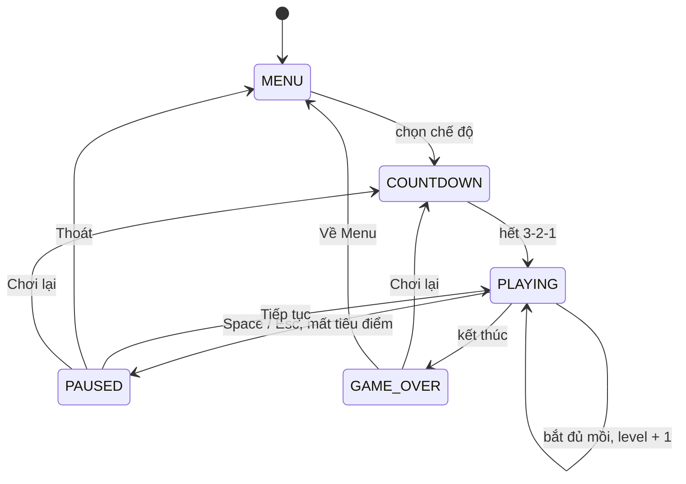
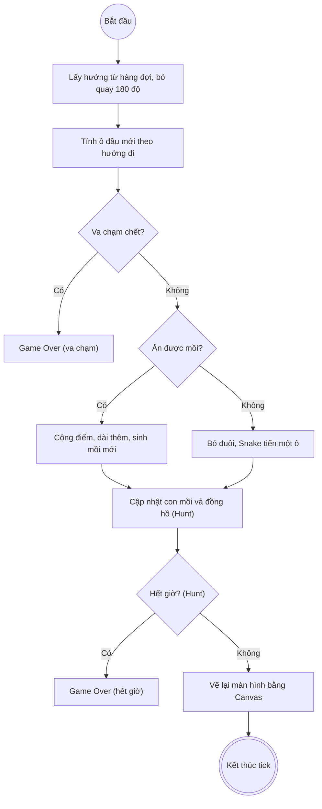

# Tài liệu thiết kế hệ thống (SDD) - Snake Adventure

11/10/2026

## 1. Giới thiệu

Tài liệu này mô tả cách Snake Adventure được xây dựng: cấu trúc phần mềm, dữ liệu, giao diện và cách các thành phần phối hợp để đáp ứng đặc tả yêu cầu (SRS) đã duyệt.

| Thông tin | Nội dung |
| --- | --- |
| Dự án | Snake Adventure - trò chơi Snake 2D trên nền tảng Web |
| Nhóm thực hiện | Nhóm 17: Trần Bình Dương, Trần Vĩnh Bảo, Mạc Nguyễn Hoàng Anh |
| Giảng viên hướng dẫn | Hoàng Quốc Dũng |
| Phiên bản | 1.0 (bản nháp) |
| Tài liệu căn cứ | Tài liệu đặc tả yêu cầu phần mềm (SRS) Snake Adventure, các mã FR, BR, NFR, UI, API được dẫn lại ở đây |
| Chuẩn trình bày | IEEE 1016 (Software Design Description), sơ đồ theo UML 2.x |

### 1.1. Phạm vi thiết kế

Thiết kế bao phủ toàn bộ chức năng FR-01 đến FR-14 của SRS: Frontend chạy trò chơi, Backend API và cơ sở dữ liệu MySQL. Các mục ngoài phạm vi SRS (nhiều người chơi trực tuyến, ứng dụng di động, khôi phục mật khẩu) không được thiết kế ở đây.

### 1.2. Quyết định thiết kế chính

| Mã | Quyết định | Lý do |
| --- | --- | --- |
| DD-01 | Toàn bộ logic chơi chạy ở Frontend, Backend chỉ lo tài khoản, điểm, Bảng xếp hạng | Độ trễ thấp, chơi được cả khi Guest hoặc Backend chậm (NFR-01, NFR-09) |
| DD-02 | Tách lõi trò chơi (game core) khỏi phần vẽ (renderer) và phần nhập (input) | Dễ kiểm thử đơn vị, dễ thêm loại con mồi (NFR-14, NFR-16) |
| DD-03 | Game Loop theo bước thời gian cố định (fixed timestep), vẽ bằng Canvas 2D | Tốc độ Snake ổn định trên mọi máy, vẽ mượt (NFR-01) |
| DD-04 | Xác thực bằng JWT, mật khẩu băm bcrypt | Đáp ứng FR-02, NFR-11, không cần lưu session phía server |
| DD-05 | Backend theo mô hình ba lớp: route, service, repository | Phân tách trách nhiệm, dễ kiểm thử API |
| DD-06 | Backend là nơi cuối cùng kiểm tra điểm hợp lệ, High Score tính từ bảng scores | Giảm gian lận cơ bản (NFR-13), không lưu dư thừa |

### 1.3. Quy ước

- Tên bảng và cột cơ sở dữ liệu dùng snake_case; tên lớp JavaScript dùng PascalCase; tên hàm và biến dùng camelCase.
- Tọa độ trên bản đồ là (x, y) theo ô, gốc (0, 0) ở góc trên trái, x tăng sang phải, y tăng xuống dưới.
- Mọi thông số trò chơi (kích thước bản đồ, tốc độ, điểm) nằm trong một tệp cấu hình, lấy giá trị đề xuất ở mục 4.1 của SRS.

## 2. Kiến trúc phần mềm

Hệ thống theo kiến trúc client-server ba tầng: trình duyệt (trình bày và logic trò chơi), máy chủ ứng dụng Node.js + Express (nghiệp vụ và API), cơ sở dữ liệu MySQL (lưu trữ).

### 2.1. Sơ đồ kiến trúc tổng thể



Trình duyệt giữ toàn bộ luật chơi; máy chủ chỉ được gọi khi đăng ký, đăng nhập, lưu điểm hoặc xem Bảng xếp hạng.

### 2.2. Thành phần và trách nhiệm

| Thành phần | Trách nhiệm | Yêu cầu liên quan |
| --- | --- | --- |
| UI Manager | Chuyển giữa các màn hình (Menu, đăng nhập, đăng ký, chơi, Game Over, Bảng xếp hạng), bắt sự kiện nút | UI-01 đến UI-08 |
| Input Handler | Nhận phím mũi tên, W A S D, Space, Esc; đưa vào hàng đợi hướng | FR-03, FR-04 |
| Game Engine | Chạy Game Loop, giữ trạng thái trò chơi, điều phối Snake, thức ăn, con mồi, va chạm, điểm | FR-03 đến FR-12 |
| Mode Strategy | Hai chiến lược chế độ chơi: ClassicMode và HuntMode, cùng giao diện chung | FR-09, FR-10 |
| Renderer | Vẽ bản đồ, Snake, thức ăn, con mồi, HUD lên Canvas 2D | UI-04, UI-05, NFR-01 |
| API Client | Gọi API bằng fetch, gắn token, xử lý lỗi và thử lại | FR-01, FR-02, FR-13, FR-14 |
| Auth Store | Giữ token và thông tin người dùng (Guest nếu chưa đăng nhập) | FR-02 |
| Route (Express) | Nhận request, kiểm tra dữ liệu đầu vào, trả response | API-01 đến API-06 |
| Service | Nghiệp vụ: đăng ký, đăng nhập, lưu điểm, tính Bảng xếp hạng | FR-01, FR-02, FR-13, FR-14 |
| Repository | Truy vấn MySQL bằng câu lệnh tham số hóa | Mục 3, NFR-12 |
| Middleware | Xác thực JWT, kiểm tra dữ liệu, giới hạn tần suất, xử lý lỗi tập trung | NFR-11 đến NFR-13 |

### 2.3. Công nghệ sử dụng

| Tầng | Công nghệ | Ghi chú |
| --- | --- | --- |
| Frontend | HTML5, CSS3, JavaScript (ES modules), Canvas 2D | Không dùng framework nặng để giữ dung lượng dưới 2 MB (NFR-02) |
| Backend | Node.js, Express | API REST, dữ liệu JSON |
| Xác thực | JSON Web Token, bcrypt | Token hạn 24 giờ (FR-02.5) |
| Cơ sở dữ liệu | MySQL 8, trình điều khiển mysql2 | Truy vấn tham số hóa, có transaction khi lưu điểm |
| Kiểm thử | Jest cho logic trò chơi, Supertest cho API | NFR-16 |
| Quản lý mã nguồn | Git | NFR-15 |

### 2.4. Mẫu thiết kế áp dụng

- **Strategy:** ClassicMode và HuntMode cùng cài đặt giao diện GameMode (init, update, onEat, isOver), Game Engine chỉ gọi qua giao diện này.
- **Factory:** PreyFactory tạo con mồi theo loại (Mouse, Bird) và level, thêm loại mới không sửa Game Engine.
- **State:** trạng thái trò chơi (MENU, PLAYING, PAUSED, GAME_OVER) được quản lý bằng máy trạng thái hữu hạn.
- **Observer (sự kiện):** Game Engine phát sự kiện (ate, caught, levelUp, gameOver); UI Manager và bộ tính điểm đăng ký lắng nghe.
- **Layered:** Backend phân tầng route, service, repository.

### 2.5. Cấu trúc thư mục

```text
snake-adventure/
├── client/
│   ├── index.html
│   ├── css/            (style.css, screens.css)
│   └── js/
│       ├── main.js
│       ├── config.js           (hằng số trò chơi)
│       ├── ui/                 (uiManager.js, screens/*.js)
│       ├── game/
│       │   ├── engine.js       (Game Loop, state machine)
│       │   ├── snake.js
│       │   ├── food.js
│       │   ├── prey/           (prey.js, mouse.js, bird.js, preyFactory.js)
│       │   ├── collision.js
│       │   ├── scoring.js
│       │   ├── modes/          (classicMode.js, huntMode.js)
│       │   ├── input.js
│       │   └── renderer.js
│       └── api/                (apiClient.js, authStore.js)
├── server/
│   ├── app.js
│   ├── config/         (db.js, env.js)
│   ├── routes/         (auth.routes.js, user.routes.js, score.routes.js, leaderboard.routes.js)
│   ├── services/       (auth.service.js, score.service.js, leaderboard.service.js)
│   ├── repositories/   (user.repo.js, score.repo.js)
│   ├── middleware/     (auth.js, validate.js, rateLimit.js, errorHandler.js)
│   └── sql/            (schema.sql, seed.sql)
├── tests/              (client/, server/)
└── README.md
```

### 2.6. Triển khai

Máy chủ Express phục vụ cả tệp tĩnh của client và API trên cùng một địa chỉ, nên không cần cấu hình CORS phức tạp. MySQL chạy cùng máy hoặc máy riêng; thông tin kết nối và khóa bí mật JWT nằm trong biến môi trường, không đưa vào mã nguồn. Triển khai thật bắt buộc dùng HTTPS (NFR-11).

## 3. Thiết kế cơ sở dữ liệu

Cơ sở dữ liệu MySQL 8 tên `snake_adventure`, bộ ký tự utf8mb4, gồm hai bảng: `users` và `scores`, quan hệ một-nhiều. High Score cá nhân và Bảng xếp hạng không lưu riêng mà tính từ `scores`, tránh dữ liệu dư thừa và sai lệch.

### 3.1. Sơ đồ thực thể liên kết (ERD)



Hai bảng đủ cho phạm vi hiện tại; High Score và hạng được suy ra từ `scores` nên không cần bảng riêng. Xóa người dùng thì xóa luôn điểm của họ.

### 3.2. Lược đồ bảng

**Bảng `users`**

| Cột | Kiểu | Ràng buộc | Mô tả |
| --- | --- | --- | --- |
| id | INT UNSIGNED | PK, AUTO_INCREMENT | Mã người dùng |
| username | VARCHAR(20) | NOT NULL, UNIQUE | Tên đăng nhập, 3-20 ký tự chữ, số, gạch dưới |
| password_hash | VARCHAR(255) | NOT NULL | Chuỗi băm bcrypt (có salt) |
| created_at | DATETIME | NOT NULL, DEFAULT CURRENT_TIMESTAMP | Ngày tạo tài khoản |

**Bảng `scores`**

| Cột | Kiểu | Ràng buộc | Mô tả |
| --- | --- | --- | --- |
| id | INT UNSIGNED | PK, AUTO_INCREMENT | Mã bản ghi |
| user_id | INT UNSIGNED | NOT NULL, FK tới users.id, ON DELETE CASCADE | Người chơi |
| mode | ENUM('classic','hunt') | NOT NULL | Chế độ chơi |
| score | INT UNSIGNED | NOT NULL, CHECK (score <= 1000000) | Điểm lượt chơi |
| level | TINYINT UNSIGNED | NOT NULL, DEFAULT 1 | Level đạt được (Hunt Mode; Classic luôn là 1) |
| duration_sec | INT UNSIGNED | NOT NULL, DEFAULT 0 | Tổng thời gian chơi, giây |
| created_at | DATETIME | NOT NULL, DEFAULT CURRENT_TIMESTAMP | Thời điểm kết thúc lượt chơi |

### 3.3. Quy tắc toàn vẹn

- Mỗi `username` là duy nhất, so sánh không phân biệt hoa thường (collation utf8mb4_0900_ai_ci).
- Xóa người dùng thì xóa luôn các bản ghi điểm của họ (ON DELETE CASCADE).
- Ngưỡng điểm tối đa 1.000.000 là giới hạn chống dữ liệu bất thường (NFR-13); Backend kiểm tra thêm theo chế độ và thời gian chơi.
- Guest không có bản ghi trong cơ sở dữ liệu (FR-13.5).

### 3.4. Chỉ mục

| Chỉ mục | Bảng | Cột | Mục đích |
| --- | --- | --- | --- |
| PRIMARY | users, scores | id | Truy cập theo khóa |
| uq_users_username | users | username | Đăng nhập, kiểm tra trùng tên (FR-01.4, FR-02.1) |
| idx_scores_mode_score | scores | mode, score DESC | Lấy Bảng xếp hạng (FR-14.2) |
| idx_scores_user_mode | scores | user_id, mode, score DESC | Lấy High Score cá nhân và hạng của người dùng (FR-11.2, FR-14.4) |

### 3.5. Mã tạo lược đồ

```sql
CREATE DATABASE IF NOT EXISTS snake_adventure
  CHARACTER SET utf8mb4 COLLATE utf8mb4_0900_ai_ci;
USE snake_adventure;

CREATE TABLE users (
  id            INT UNSIGNED NOT NULL AUTO_INCREMENT,
  username      VARCHAR(20)  NOT NULL,
  password_hash VARCHAR(255) NOT NULL,
  created_at    DATETIME     NOT NULL DEFAULT CURRENT_TIMESTAMP,
  PRIMARY KEY (id),
  UNIQUE KEY uq_users_username (username)
) ENGINE=InnoDB;

CREATE TABLE scores (
  id           INT UNSIGNED NOT NULL AUTO_INCREMENT,
  user_id      INT UNSIGNED NOT NULL,
  mode         ENUM('classic','hunt') NOT NULL,
  score        INT UNSIGNED NOT NULL,
  level        TINYINT UNSIGNED NOT NULL DEFAULT 1,
  duration_sec INT UNSIGNED NOT NULL DEFAULT 0,
  created_at   DATETIME NOT NULL DEFAULT CURRENT_TIMESTAMP,
  PRIMARY KEY (id),
  CONSTRAINT fk_scores_user FOREIGN KEY (user_id)
    REFERENCES users(id) ON DELETE CASCADE,
  CONSTRAINT ck_scores_max CHECK (score <= 1000000),
  KEY idx_scores_mode_score (mode, score DESC),
  KEY idx_scores_user_mode (user_id, mode, score DESC)
) ENGINE=InnoDB;
```

### 3.6. Truy vấn chính

| Chức năng | Truy vấn (tham số hóa) |
| --- | --- |
| Kiểm tra trùng tên (FR-01.4) | `SELECT id FROM users WHERE username = ?` |
| Đăng ký (FR-01.5) | `INSERT INTO users (username, password_hash) VALUES (?, ?)` |
| Đăng nhập (FR-02.1) | `SELECT id, username, password_hash FROM users WHERE username = ?` |
| Lưu điểm (FR-13) | `INSERT INTO scores (user_id, mode, score, level, duration_sec) VALUES (?, ?, ?, ?, ?)` |
| High Score cá nhân (FR-13.3) | `SELECT MAX(score) AS best FROM scores WHERE user_id = ? AND mode = ?` |
| Bảng xếp hạng Classic (FR-14.2) | Xem mã bên dưới |
| Bảng xếp hạng Hunt (FR-14.2) | Xem mã bên dưới |
| Hạng của một người dùng (FR-14.4) | Đếm số người có điểm tốt nhất cao hơn điểm tốt nhất của người đó, cộng 1 |

```sql
-- Bảng xếp hạng Classic: điểm cao nhất mỗi người, bằng điểm thì ai đạt sớm hơn xếp trên
SELECT u.username, b.best_score, b.achieved_at
FROM (
  SELECT user_id, MAX(score) AS best_score, MIN(created_at) AS achieved_at
  FROM scores WHERE mode = 'classic'
  GROUP BY user_id
) b JOIN users u ON u.id = b.user_id
ORDER BY b.best_score DESC, b.achieved_at ASC
LIMIT 10;

-- Bảng xếp hạng Hunt: điểm cao nhất; bằng điểm thì thời gian ngắn hơn xếp trên
SELECT u.username, s.score, s.level, s.duration_sec
FROM scores s
JOIN (
  SELECT user_id, MAX(score) AS best_score
  FROM scores WHERE mode = 'hunt' GROUP BY user_id
) b ON b.user_id = s.user_id AND b.best_score = s.score
JOIN users u ON u.id = s.user_id
WHERE s.mode = 'hunt'
ORDER BY s.score DESC, s.duration_sec ASC
LIMIT 10;
```

Lưu ý: Truy vấn Hunt có thể trả nhiều dòng cho một người nếu họ có nhiều lượt trùng điểm cao nhất; tầng Service giữ dòng đầu tiên của mỗi người trước khi trả về.

### 3.7. Giao dịch và sao lưu

- Lưu điểm gồm một lệnh INSERT, không cần transaction nhiều bước; nếu sau này thêm bảng thành tích hoặc lịch sử thì bọc trong một transaction (NFR-08).
- Sao lưu định kỳ bằng `mysqldump`; dữ liệu mẫu (seed.sql) dùng cho môi trường kiểm thử.

## 4. Thiết kế giao diện (UI/UX)

Giao diện hướng tới người chơi bằng bàn phím trên máy tính: ít bước, vào chơi ngay, mọi thông tin cần thiết nằm cạnh bản đồ. Có 8 màn hình theo SRS (UI-01 đến UI-08).

### 4.1. Nguyên tắc UX

- **Vào chơi trong 2 thao tác:** từ Menu chính bấm một nút chế độ là chơi; không bắt buộc đăng nhập (Guest).
- **Bàn phím là chính, chuột là phụ:** mọi thao tác chơi dùng phím; nút bấm chỉ phục vụ điều hướng menu.
- **Phản hồi tức thì:** điểm đổi ngay khi ăn, bản đồ có hiệu ứng nhấp nháy ngắn khi bắt mồi, thông báo lỗi nằm cạnh trường lỗi.
- **Không gây cuộn trang:** phím mũi tên và Space bị chặn hành vi mặc định khi đang chơi.
- **Nhất quán:** cùng một kiểu nút, một bảng màu, một vị trí cho điểm và thời gian ở mọi chế độ.

### 4.2. Phong cách hình ảnh

Nền tối giúp Snake và mồi nổi bật, kiểu pixel gọn gàng. Màu dùng có ý nghĩa nhất quán và có độ tương phản đủ; không phân biệt đối tượng chỉ bằng màu (mồi khác hình dạng).

| Thành phần | Màu đề xuất | Dùng cho |
| --- | --- | --- |
| Nền trang | #0F1B22 | Nền toàn trang |
| Bản đồ | #16262F, đường lưới #1F3541 | Khu vực chơi |
| Đầu Snake | #7CE38B | Ô đầu, có hai chấm mắt |
| Thân Snake | #3FA55B | Các đốt thân, đốt cuối nhạt dần |
| Thức ăn | #FF5A5F | Hình tròn, Classic Mode |
| Chuột | #C9B48A | Hình chuột tròn kèm đuôi (Hunt Mode) |
| Chim | #5BC0FF | Hình tam giác cánh (Hunt Mode) |
| Nhấn / nút chính | #FFC857 | Nút Chơi, điểm nổi bật, đồng hồ khi dưới 10 giây |
| Chữ | #E8F1F2, chữ phụ #9FB4BC | Văn bản |
| Lỗi | #FF6B6B | Thông báo lỗi biểu mẫu |

Chữ: tiêu đề dùng phông pixel (ví dụ Press Start 2P, có phông dự phòng sans-serif), nội dung dùng Inter hoặc Segoe UI cỡ 14-16 px. Nút bo góc 8 px, chiều cao tối thiểu 40 px.

### 4.3. Sơ đồ luồng màn hình



Người chơi vào Menu chính bằng đăng nhập hoặc chơi khách; từ Menu đi tới hai chế độ chơi hoặc Bảng xếp hạng, và mọi lượt chơi kết thúc ở Game Over. Màn chơi gồm Classic Mode và Hunt Mode; cả hai đều có Tạm dừng và kết thúc ở Game Over. Game Over: Chơi lại quay về màn chơi, Lưu điểm cần đăng nhập, Về Menu quay về Menu chính.

### 4.4. Bố cục các màn hình (wireframe)

Ba wireframe minh họa bố cục điển hình; các màn hình còn lại theo cùng khung và cùng kiểu nút. Màu sắc và phông thực tế theo mục 4.2.

**UI-03 · Menu chính**

```text
+--------------------------+
|     SNAKE ADVENTURE      |
|     Xin chào, Khách      |
|                          |
|  [ 1  Classic Mode     ] |
|  [ 2  Hunt Mode        ] |
|  [ 3  Bảng xếp hạng    ] |
|  [ Đăng nhập           ] |
|                          |
|  Phím 1, 2, 3 để chọn    |
+--------------------------+
```

**UI-05 · Hunt Mode**

```text
+--------------------------+
| Level 2    0:42   Điểm 230|
|          Mồi 1/4         |
| +----------------------+ |
| |                  o   | |
| |                      | |
| |    [S][s][s]         | |
| |       [s]            | |
| |                  ^   | |
| +----------------------+ |
|  Mũi tên / WASD · Space  |
|        tạm dừng          |
+--------------------------+
 S = đầu Snake, s = thân, o = chuột, ^ = chim
```

**UI-07 · Game Over**

```text
+--------------------------+
|        GAME OVER         |
|       Điểm: 230          |
|   Level đạt được: 2      |
|  [ Phá kỷ lục cá nhân! ] |
|                          |
|  [ Chơi lại            ] |
|  [ Lưu điểm            ] |
|  [ Về Menu             ] |
+--------------------------+
```

### 4.5. Đặc tả từng màn hình

| Mã | Màn hình | Hành vi và trạng thái | Xử lý lỗi, trường hợp biên |
| --- | --- | --- | --- |
| UI-01 | Đăng ký | Nút Đăng ký bị khóa đến khi cả 3 ô có nội dung; kiểm tra khi rời ô; Enter gửi biểu mẫu | Lỗi theo từng trường: trống, quá ngắn, không khớp, đã tồn tại; lỗi mạng hiện thông báo chung kèm Thử lại |
| UI-02 | Đăng nhập | Enter gửi biểu mẫu; có nút "Chơi với tư cách khách" về Menu | Sai thông tin hiện một dòng "Tên đăng nhập hoặc mật khẩu không đúng"; khóa tạm khi đăng nhập sai nhiều lần |
| UI-03 | Menu chính | Hiển thị tên người dùng hoặc "Khách", High Score của từng chế độ nếu đã đăng nhập; phím 1 = Classic, 2 = Hunt, 3 = Bảng xếp hạng | Guest thấy nút Đăng nhập thay cho Đăng xuất; khi token hết hạn tự về trạng thái Guest |
| UI-04 | Classic Mode | HUD trên cùng: Điểm, High Score, nút Tạm dừng; bản đồ chiếm phần còn lại; đếm ngược 3-2-1 trước khi Snake chạy | Mất tiêu điểm cửa sổ thì tự Tạm dừng |
| UI-05 | Hunt Mode | HUD: Level, Đồng hồ đếm ngược, Mồi đã bắt trên yêu cầu, Điểm; đồng hồ đổi màu nhấn khi dưới 10 giây; thông báo "Level N" giữa màn | Hết giờ hoặc va chạm chuyển sang Game Over; mất tiêu điểm thì tạm dừng và dừng đồng hồ |
| UI-06 | Tạm dừng | Lớp phủ mờ lên bản đồ với 3 nút: Tiếp tục, Chơi lại, Thoát về Menu; Space hoặc Esc để Tiếp tục | Chơi lại và Thoát hỏi xác nhận vì lượt đang dở không được lưu |
| UI-07 | Game Over | Hiện điểm, level (Hunt), thông báo phá kỷ lục; 3 nút: Chơi lại (mặc định, phím Enter), Lưu điểm, Về Menu | Guest: nút Lưu điểm dẫn tới Đăng nhập; lưu lỗi mạng: giữ nút, cho Thử lại; lưu xong nút chuyển thành "Đã lưu" |
| UI-08 | Bảng xếp hạng | Hai thẻ Classic và Hunt; bảng top 10 gồm hạng, tên, điểm (Hunt thêm level, thời gian); dòng của người dùng hiện tại được làm nổi | Rỗng: "Chưa có người chơi nào"; lỗi tải: thông báo và nút Tải lại |

### 4.6. Điều khiển và phím tắt

| Phím | Tác dụng | Màn hình |
| --- | --- | --- |
| Mũi tên, W A S D | Đổi hướng Snake | Màn chơi |
| Space hoặc Esc | Tạm dừng / Tiếp tục | Màn chơi, Tạm dừng |
| Enter | Xác nhận nút mặc định, gửi biểu mẫu | Biểu mẫu, Game Over |
| 1, 2, 3 | Chọn mục Menu | Menu chính |
| Tab, Shift+Tab | Di chuyển giữa các nút và ô nhập | Mọi màn hình |

### 4.7. Khả năng truy cập và co giãn

- Tương phản chữ và nền đạt tối thiểu 4,5:1; nút và ô nhập có viền tiêu điểm rõ khi dùng Tab.
- Thông báo lỗi biểu mẫu có thuộc tính aria-live để trình đọc màn hình đọc được.
- Bản đồ vẽ trên Canvas có kích thước theo ô, tự co theo chiều cao khung nhìn nhưng giữ tỷ lệ vuông; giao diện đạt yêu cầu từ 1366 x 768 trở lên (NFR-07).
- Giảm hiệu ứng nhấp nháy khi hệ điều hành bật chế độ giảm chuyển động.

## 5. Các sơ đồ UML

Năm sơ đồ dưới đây mô tả hệ thống từ nhiều góc nhìn: ai làm gì (use case), cấu trúc lớp, trình tự gọi giữa các thành phần, vòng đời trạng thái và luồng xử lý của một nhịp trò chơi.

### 5.1. Sơ đồ ca sử dụng (Use Case)



| Mã | Ca sử dụng | Tác nhân | Chức năng SRS |
| --- | --- | --- | --- |
| UC-01 | Đăng ký tài khoản | Guest | FR-01 |
| UC-02 | Đăng nhập | Guest | FR-02 |
| UC-03 | Đăng xuất | Registered User | FR-02 |
| UC-04 | Chơi Classic Mode | Guest, Registered User | FR-04 đến FR-09 |
| UC-05 | Chơi Hunt Mode | Guest, Registered User | FR-04 đến FR-08, FR-10 |
| UC-06 | Tạm dừng / tiếp tục / thoát | Guest, Registered User | FR-03 |
| UC-07 | Chơi lại | Guest, Registered User | FR-12 |
| UC-08 | Lưu thành tích | Registered User | FR-13 |
| UC-09 | Xem Bảng xếp hạng | Guest, Registered User | FR-14 |

Quan hệ: Registered User kế thừa Guest (làm được mọi việc của Guest). UC-04 và UC-05 cùng «include» Game Over (FR-11); Game Over «extend» sang Lưu thành tích khi người chơi đã đăng nhập và chọn Lưu điểm.

### 5.2. Sơ đồ lớp

Sơ đồ lớp dưới đây là lõi trò chơi ở phía client.



Các lớp phía server theo mô hình ba lớp:

| Lớp (server) | Trách nhiệm | Phương thức chính |
| --- | --- | --- |
| AuthRoute | Nhận request đăng ký, đăng nhập, đăng xuất, thông tin cá nhân | POST /register, POST /login, POST /logout, GET /me |
| AuthService | Kiểm tra dữ liệu, băm và đối chiếu mật khẩu, ký và kiểm tra JWT | register(dto), login(dto), verifyToken(token) |
| ScoreService | Kiểm tra điểm hợp lệ, ghi điểm, trả High Score | saveScore(userId, dto), getBest(userId, mode) |
| LeaderboardService | Lấy top N theo chế độ, gom mỗi người một dòng, tính hạng cá nhân | getTop(mode, limit), getRank(userId, mode) |
| UserRepository | Truy vấn bảng users | findByUsername(name), create(name, hash) |
| ScoreRepository | Truy vấn bảng scores | insert(row), maxScore(userId, mode), top(mode, limit) |
| AuthMiddleware | Đọc token, gắn userId vào request, trả 401 nếu sai | authenticate(req, res, next) |

Quan hệ chính: Route gọi Service, Service gọi Repository; Service không biết gì về HTTP, Repository không biết gì về nghiệp vụ.

### 5.3. Sơ đồ tuần tự (Sequence)

**5.3.1. Lưu thành tích sau Game Over (FR-11, FR-13)**



Token sai hoặc thiếu: Route trả 401; dữ liệu sai: trả 400; lỗi mạng: UI cho phép Thử lại.

**5.3.2. Đăng nhập (FR-02)**

1. Người chơi nhập Username, Password và bấm Đăng nhập; LoginScreen kiểm tra không để trống.
2. API Client gửi POST /api/auth/login với JSON gồm username và password.
3. AuthRoute chuyển cho AuthService.login.
4. AuthService gọi UserRepository.findByUsername; nếu không có người dùng thì trả lỗi 401 chung.
5. AuthService so sánh mật khẩu với password_hash bằng bcrypt; sai thì trả 401 chung.
6. Đúng thì AuthService ký JWT (chứa id, username, hạn 24 giờ) và trả về token cùng thông tin người dùng.
7. API Client lưu token vào Auth Store; UI Manager chuyển sang Menu chính và hiển thị tên người dùng.

### 5.4. Sơ đồ trạng thái (State)

Game Engine quản lý vòng đời một lượt chơi bằng máy trạng thái hữu hạn.



| Từ trạng thái | Sự kiện | Đến trạng thái | Hành động |
| --- | --- | --- | --- |
| MENU | Chọn chế độ | COUNTDOWN | Khởi tạo Snake, thức ăn hoặc con mồi, đồng hồ |
| COUNTDOWN | Hết đếm ngược 3-2-1 | PLAYING | Khởi động Game Loop |
| PLAYING | Space/Esc hoặc mất tiêu điểm | PAUSED | Đóng băng cập nhật và đồng hồ |
| PAUSED | Space/Esc hoặc Tiếp tục | PLAYING | Chạy lại Game Loop |
| PAUSED | Thoát | MENU | Dọn dẹp trạng thái, không lưu điểm |
| PAUSED | Chơi lại | COUNTDOWN | Đặt lại mọi biến trạng thái |
| PLAYING | Va chạm chết, hết giờ, bản đồ đầy | GAME_OVER | Dừng Game Loop, tính kỷ lục |
| PLAYING | Bắt đủ mồi (Hunt) | PLAYING | Tăng level, đặt lại đồng hồ (trạng thái con LEVEL_UP ngắn) |
| GAME_OVER | Chơi lại | COUNTDOWN | Đặt lại mọi biến trạng thái |
| GAME_OVER | Về Menu | MENU | Dọn dẹp |

### 5.5. Sơ đồ hoạt động (Activity): một tick của Game Loop

Mỗi tick (mặc định 125 ms ở Classic Mode) Game Engine thực hiện các bước sau theo thứ tự cố định; thứ tự này bảo đảm kết quả kiểm thử lặp lại được (FR-08.1).



Classic Mode bỏ qua đồng hồ và nhánh Hết giờ.

## 6. Đặc tả API

API theo kiểu REST, dữ liệu JSON (UTF-8). Frontend và API cùng một địa chỉ gốc nên đường dẫn viết tương đối.

### 6.1. Quy ước chung

| Hạng mục | Quy ước |
| --- | --- |
| Địa chỉ gốc | /api |
| Định dạng | Request và response là application/json |
| Xác thực | Header `Authorization: Bearer <token>` cho API cần đăng nhập |
| Token | JWT ký HS256, nội dung gồm sub (id), username, iat, exp; hạn 24 giờ |
| Thời gian | Chuỗi ISO 8601, múi giờ UTC |
| Giới hạn tần suất | Đăng nhập: 5 lần sai trong 15 phút mỗi địa chỉ IP thì trả 429; lưu điểm: 30 lần mỗi phút mỗi người dùng |

Định dạng lỗi thống nhất:

```json
{
  "error": {
    "code": "VALIDATION_ERROR",
    "message": "Dữ liệu không hợp lệ",
    "details": { "username": "Tên đăng nhập phải dài 3-20 ký tự" }
  }
}
```

| Mã HTTP | code | Khi nào |
| --- | --- | --- |
| 400 | VALIDATION_ERROR | Dữ liệu thiếu hoặc sai định dạng |
| 401 | UNAUTHORIZED | Thiếu, sai hoặc hết hạn token |
| 401 | INVALID_CREDENTIALS | Sai tên đăng nhập hoặc mật khẩu |
| 409 | USERNAME_TAKEN | Tên đăng nhập đã tồn tại |
| 429 | TOO_MANY_REQUESTS | Vượt giới hạn tần suất |
| 500 | INTERNAL_ERROR | Lỗi máy chủ; thông điệp chung, chi tiết chỉ ghi log |

### 6.2. Quy tắc kiểm tra dữ liệu

| Trường | Quy tắc |
| --- | --- |
| username | Chuỗi 3-20 ký tự, chỉ chữ cái, số, gạch dưới; không phân biệt hoa thường khi kiểm tra trùng |
| password | Chuỗi tối thiểu 6 ký tự, tối đa 72 ký tự (giới hạn của bcrypt) |
| confirmPassword | Phải bằng password |
| mode | Một trong classic, hunt |
| score | Số nguyên từ 0 đến 1.000.000; Backend còn kiểm tra tối đa hợp lý theo thời gian chơi |
| level | Số nguyên từ 1 đến 50; chế độ classic bắt buộc bằng 1 |
| durationSec | Số nguyên từ 0 đến 86.400 |
| limit | Số nguyên từ 1 đến 50, mặc định 10 |

### 6.3. API-01 Đăng ký

`POST /api/auth/register` (không cần token; FR-01)

```json
// Request
{ "username": "snake_master", "password": "s3cret99", "confirmPassword": "s3cret99" }

// 201 Created
{ "message": "Đăng ký thành công", "user": { "id": 12, "username": "snake_master" } }
```

Lỗi: 400 VALIDATION_ERROR (kèm details theo từng trường), 409 USERNAME_TAKEN.

### 6.4. API-02 Đăng nhập

`POST /api/auth/login` (không cần token; FR-02)

```json
// Request
{ "username": "snake_master", "password": "s3cret99" }

// 200 OK
{
  "token": "eyJhbGciOi...",
  "expiresIn": 86400,
  "user": { "id": 12, "username": "snake_master" }
}
```

Lỗi: 400 VALIDATION_ERROR, 401 INVALID_CREDENTIALS (thông điệp chung, không nói trường nào sai), 429 TOO_MANY_REQUESTS.

### 6.5. API-03 Đăng xuất

`POST /api/auth/logout` (cần token; FR-02.4)

Response: 204 No Content. Vì JWT không lưu phía server, Frontend xóa token khỏi Auth Store; API này dùng để ghi nhận đăng xuất và là chỗ để thêm danh sách thu hồi token sau này. Lỗi: 401 UNAUTHORIZED.

### 6.6. API-04 Thông tin người dùng hiện tại

`GET /api/users/me` (cần token; FR-02, FR-13)

```json
// 200 OK
{
  "id": 12,
  "username": "snake_master",
  "createdAt": "2026-10-05T08:30:00Z",
  "highScores": { "classic": 320, "hunt": 1180 }
}
```

HighScores bằng 0 nếu người dùng chưa chơi chế độ đó. Lỗi: 401 UNAUTHORIZED.

### 6.7. API-05 Lưu điểm

`POST /api/scores` (cần token; FR-13)

```json
// Request
{ "mode": "hunt", "score": 1240, "level": 4, "durationSec": 215 }

// 201 Created
{
  "id": 981,
  "saved": true,
  "best": { "mode": "hunt", "score": 1240 },
  "isNewRecord": true
}
```

Backend luôn ghi lượt chơi vào `scores`; `best` là điểm cao nhất sau khi ghi, `isNewRecord` bằng true khi điểm mới lớn hơn kỷ lục cũ. Lỗi: 400 VALIDATION_ERROR (điểm âm, vượt ngưỡng, chế độ sai), 401 UNAUTHORIZED, 429 TOO_MANY_REQUESTS.

### 6.8. API-06 Bảng xếp hạng

`GET /api/leaderboard?mode=classic&limit=10` (không bắt buộc token; FR-14)

```json
// 200 OK
{
  "mode": "classic",
  "items": [
    { "rank": 1, "username": "snake_master", "score": 320 },
    { "rank": 2, "username": "linh_vn", "score": 290 }
  ],
  "me": { "rank": 15, "score": 120 }
}
```

Với mode=hunt, mỗi phần tử có thêm `level` và `durationSec`. Trường `me` chỉ xuất hiện khi request có token hợp lệ và người dùng đã có điểm trong chế độ đó; nếu không thì là null. Mỗi người chỉ xuất hiện một lần, theo điểm cao nhất. Lỗi: 400 VALIDATION_ERROR (mode hoặc limit sai).

### 6.9. Quy ước cho Frontend gọi API

- API Client gắn token vào mọi request cần đăng nhập; nhận 401 thì xóa token và chuyển về trạng thái Guest.
- Lỗi mạng hoặc 5xx: hiển thị thông báo chung và nút Thử lại; việc lưu điểm cho phép thử lại tối đa 3 lần liên tiếp bằng thao tác của người chơi, không tự động lặp vô hạn.
- Bảng xếp hạng được lấy lại mỗi lần mở màn hình, có thể lưu đệm trong 30 giây phía client.

## 7. Thiết kế chi tiết lõi trò chơi, bảo mật và xử lý lỗi

### 7.1. Biểu diễn dữ liệu trong trò chơi

- Bản đồ là lưới `COLS x ROWS` ô (mặc định 20 x 20). Mỗi vị trí là `Point { x, y }`, nguyên, từ 0.
- `Direction` là một trong bốn vector: UP (0, -1), DOWN (0, 1), LEFT (-1, 0), RIGHT (1, 0).
- Thân Snake là mảng `Point[]` với phần tử đầu là đầu Snake; kèm tập (Set) khóa "x,y" của thân để kiểm tra va chạm trong thời gian hằng số.
- Hàng đợi hướng tối đa 2 lệnh; lệnh mới bị bỏ nếu ngược với hướng cuối cùng đã xếp hàng hoặc trùng với nó (FR-04.2, FR-04.4).

### 7.2. Game Loop bước thời gian cố định

Vòng lặp dùng `requestAnimationFrame` để vẽ nhưng cập nhật logic theo bước cố định `tickMs`, nên tốc độ Snake không phụ thuộc tốc độ máy (NFR-01).

```javascript
function frame(now) {
  if (state !== 'PLAYING') return;          // PAUSED, GAME_OVER: không chạy
  acc += now - last; last = now;
  while (acc >= tickMs) {                   // có thể bù nhiều tick nếu máy chậm
    mode.update(tickMs);                    // một tick logic (xem sơ đồ hoạt động)
    acc -= tickMs;
    if (state !== 'PLAYING') break;
  }
  renderer.draw(game);                      // vẽ một lần mỗi khung hình
  requestAnimationFrame(frame);
}
```

Khi Tạm dừng hoặc mất tiêu điểm, engine ghi lại thời điểm dừng; khi tiếp tục thì đặt lại `last` và `acc` để không bù tick dồn (FR-03.3). Đồng hồ Hunt Mode cộng dồn theo `tickMs`, không dùng `Date.now()`, nên tạm dừng không làm lệch thời gian.

### 7.3. Sinh thức ăn và vị trí con mồi

1. Lấy danh sách ô trống = toàn bộ ô trừ ô thân Snake (và ô con mồi nếu có).
2. Nếu danh sách rỗng: bản đồ đầy, phát sự kiện `gameOver(win)` (FR-05.4).
3. Chọn ngẫu nhiên đều một ô trong danh sách. Cách này tránh vòng lặp thử lại vô hạn khi thân Snake dài.
4. Con mồi mới: chọn ô trống cách đầu Snake tối thiểu 5 ô (khoảng cách Manhattan); nếu không có ô nào thì giảm khoảng cách tối thiểu dần đến 1 (FR-06.1).

### 7.4. Thuật toán di chuyển của con mồi

Con mồi cập nhật mỗi `preyTickMs` (lớn hơn `tickMs` của Snake với chuột, bằng hoặc nhỏ hơn với chim). Mọi lựa chọn đều lọc ô hợp lệ: trong biên, không phải ô thân Snake.

```javascript
// Mouse: đi ngẫu nhiên, giữ hướng vài ô rồi mới đổi
function mouseStep(prey, game) {
  if (prey.stepsLeft === 0) { prey.dir = randomValidDir(prey, game); prey.stepsLeft = randInt(2, 4); }
  const next = add(prey.pos, prey.dir);
  if (!isFree(next, game)) { prey.dir = randomValidDir(prey, game); prey.stepsLeft = randInt(2, 4); return; }
  prey.pos = next; prey.stepsLeft--;
}

// Bird: né đầu Snake khi lại gần, ngoài ra bay ngẫu nhiên
function birdStep(prey, game) {
  const d = manhattan(prey.pos, game.snake.head);
  if (d <= FLEE_RADIUS) {                    // FLEE_RADIUS = 4
    const options = validDirs(prey, game);   // các hướng đi được
    prey.dir = maxBy(options, dir => manhattan(add(prey.pos, dir), game.snake.head));
  } else if (Math.random() < 0.3) {
    prey.dir = randomValidDir(prey, game);
  }
  const next = add(prey.pos, prey.dir);
  if (isFree(next, game)) prey.pos = next;
}
```

Nếu mọi hướng đều bị chặn, con mồi đứng yên một tick. Điều kiện bắt: đầu Snake vào ô con mồi, hoặc đầu và con mồi đổi chỗ cho nhau trong cùng tick (BR-02).

### 7.5. Tiến triển độ khó của Hunt Mode

| Level | Thời gian màn | Số mồi yêu cầu | Tốc độ chuột (so với Snake) | Tốc độ chim | Tỷ lệ chim |
| --- | --- | --- | --- | --- | --- |
| 1 | 60 giây | 3 | 60% | Không có | 0% |
| 2 | 57 giây | 3 | 65% | 100% | 30% |
| 3 | 54 giây | 4 | 70% | 105% | 40% |
| 4 | 51 giây | 4 | 75% | 110% | 50% |
| 5 trở lên | giảm 3 giây mỗi level, tối thiểu 30 giây | tăng 1 mỗi 2 level, tối đa 8 | tăng 5% mỗi level, tối đa 95% | tăng 5% mỗi level, tối đa 130% | tối đa 70% |

Bảng là giá trị đề xuất, nằm trong tệp cấu hình để tinh chỉnh sau khi chơi thử. Mỗi lần chuyển level, đồng hồ đặt lại, con mồi mới xuất hiện và Snake giữ nguyên chiều dài (FR-10.3).

### 7.6. Tính điểm

Bộ ScoreKeeper nhận sự kiện `ate` và `caught` từ engine: Classic +10 mỗi thức ăn; Hunt: điểm cơ bản của loại mồi cộng điểm thưởng thời gian bằng điểm cơ bản nhân (thời gian còn lại / thời gian màn), cộng 100 nhân level khi qua màn (BR-04). Điểm làm tròn xuống số nguyên.

### 7.7. Xử lý lỗi và trường hợp biên

| Tình huống | Cách xử lý |
| --- | --- |
| Mất kết nối khi đăng nhập hoặc lưu điểm | Thông báo, giữ kết quả trên màn Game Over, cho Thử lại; Guest vẫn chơi bình thường (NFR-09) |
| Token hết hạn khi lưu điểm | Nhận 401: xóa token, đưa người chơi về đăng nhập, giữ điểm lượt vừa chơi để lưu sau khi đăng nhập |
| Người chơi chuyển tab hoặc thu nhỏ cửa sổ | Tự Tạm dừng và dừng đồng hồ (UI-04, UI-05) |
| Nhấn phím liên tục rất nhanh | Hàng đợi hướng giới hạn 2 lệnh, lệnh vô hiệu bị bỏ (FR-04.4) |
| Restart nhiều lần | Hủy `requestAnimationFrame` cũ và bộ lắng nghe sự kiện trước khi tạo mới để không rò rỉ (NFR-10) |
| Lỗi cơ sở dữ liệu | Trả 500 INTERNAL_ERROR với thông điệp chung, ghi log chi tiết ở server |
| Dữ liệu API bất thường | Trả 400, không ghi vào cơ sở dữ liệu |

### 7.8. Bảo mật

| Mối đe dọa | Biện pháp | Yêu cầu |
| --- | --- | --- |
| Lộ mật khẩu | Băm bcrypt (cost 10 trở lên), không ghi log mật khẩu, không trả password_hash ra API | NFR-11 |
| Dò mật khẩu | Giới hạn 5 lần sai trong 15 phút mỗi IP, thông báo lỗi chung | NFR-12 |
| SQL injection | Chỉ dùng truy vấn tham số hóa (mysql2 placeholders) | NFR-12 |
| XSS | Hiển thị tên người chơi bằng textContent hoặc escape; không dùng innerHTML với dữ liệu người dùng | NFR-12 |
| Đánh cắp hoặc giả mạo token | JWT ký bằng khóa bí mật trong biến môi trường, hạn 24 giờ, truyền qua HTTPS; Backend kiểm tra chữ ký và hạn mỗi request | NFR-11 |
| Gửi điểm giả | Chỉ chấp nhận khi có token hợp lệ; kiểm tra khoảng giá trị và mức hợp lý theo thời gian chơi; giới hạn 30 lần lưu mỗi phút. Vì logic chơi chạy ở client nên đây chỉ giảm gian lận ở mức cơ bản, không chống được hoàn toàn | NFR-13 |
| Lộ thông tin lỗi | Trình xử lý lỗi tập trung ẩn chi tiết nội bộ khỏi người dùng | NFR-12 |

### 7.9. Cấu hình

| Nơi cấu hình | Nội dung |
| --- | --- |
| client/js/config.js | COLS, ROWS, CELL_SIZE, tick Snake, tham số tăng tốc, bảng điểm, bảng level Hunt, FLEE_RADIUS |
| Biến môi trường server | PORT, DB_HOST, DB_USER, DB_PASSWORD, DB_NAME, JWT_SECRET, JWT_EXPIRES_IN |
| Tệp .env.example | Mẫu biến môi trường, không chứa giá trị bí mật thật |

### 7.10. Thiết kế để kiểm thử

- Mô-đun game (snake, food, prey, collision, scoring, modes) không truy cập DOM, Canvas hay thời gian thật; nhận tham số và bộ sinh số ngẫu nhiên có thể thay thế bằng giá trị cố định, nên kiểm thử đơn vị bằng Jest cho kết quả lặp lại.
- Service của Backend nhận Repository qua tham số, nên kiểm thử bằng Repository giả; kiểm thử API bằng Supertest trên cơ sở dữ liệu thử.
- Mỗi mã kiểm thử TC trong SRS ánh xạ tới một hàm hoặc API cụ thể ở mục 8.

## 8. Truy vết yêu cầu SRS sang thiết kế

### 8.1. Ma trận truy vết chức năng

| Yêu cầu SRS | Thành phần thiết kế (client / server) | Dữ liệu, API | Giao diện | UML |
| --- | --- | --- | --- | --- |
| FR-01 Đăng ký | AuthRoute, AuthService, UserRepository | users, API-01 | UI-01 | UC-01, mục 2.2 |
| FR-02 Đăng nhập / Đăng xuất | AuthService, AuthMiddleware, Auth Store, API Client | users, API-02 đến API-04 | UI-02, UI-03 | UC-02, UC-03, sequence 5.3.2 |
| FR-03 Quản lý trò chơi | GameEngine, UI Manager, Input Handler | Không | UI-04 đến UI-06 | UC-06, state 5.4 |
| FR-04 Điều khiển Snake | Input Handler, Snake | Không | UI-04, UI-05 | class Snake, activity 5.5 |
| FR-05 Thức ăn | Food | Không | UI-04 | class Food, mục 7.3 |
| FR-06 Con mồi | Prey, Mouse, Bird, PreyFactory | Không | UI-05 | class Prey, mục 7.4 |
| FR-07 Tính điểm | ScoreKeeper | Không | UI-04, UI-05 (HUD) | class ScoreKeeper, mục 7.6 |
| FR-08 Va chạm | Collision | Không | Không | activity 5.5 |
| FR-09 Classic Mode | ClassicMode | scores (mode = classic) | UI-04 | UC-04, class ClassicMode |
| FR-10 Hunt Mode | HuntMode | scores (mode = hunt) | UI-05 | UC-05, class HuntMode, mục 7.5 |
| FR-11 Game Over | GameEngine (state GAME_OVER), UI Manager | Không | UI-07 | UC-10, state 5.4 |
| FR-12 Restart | GameEngine.restart | Không | UI-06, UI-07 | UC-07, state 5.4 |
| FR-13 Lưu thành tích | ScoreService, ScoreRepository, API Client | scores, API-05 | UI-07 | UC-08, sequence 5.3.1 |
| FR-14 Bảng xếp hạng | LeaderboardService, ScoreRepository | scores, API-06 | UI-08 | UC-09 |

### 8.2. Ma trận truy vết phi chức năng

| Yêu cầu | Biện pháp thiết kế | Vị trí |
| --- | --- | --- |
| NFR-01, NFR-02 Hiệu năng giao diện | Game Loop bước cố định, Canvas 2D, không dùng framework nặng | 2.3, 7.2 |
| NFR-03 API nhanh | Chỉ mục (mode, score), truy vấn tối ưu | 3.4, 3.6 |
| NFR-04, NFR-05 Khả năng sử dụng | Wireframe nhất quán, thông báo ngay cạnh lỗi, phím tắt | 4.1, 4.5, 4.6 |
| NFR-06, NFR-07 Tương thích | HTML5 chuẩn, ES modules, bố cục từ 1366 x 768 | 2.3, 4.7 |
| NFR-08, NFR-09, NFR-10 Độ tin cậy | Ghi điểm có kiểm tra, xử lý lỗi mạng, dọn dẹp khi Restart | 3.7, 7.7 |
| NFR-11 đến NFR-13 Bảo mật | bcrypt, JWT, truy vấn tham số hóa, giới hạn tần suất, kiểm tra điểm | 6.1, 7.8 |
| NFR-14 đến NFR-16 Bảo trì | Phân module, Strategy và Factory, cấu hình tập trung, thiết kế để kiểm thử | 2.4, 2.5, 7.9, 7.10 |

### 8.3. Vấn đề còn mở và giả định cần nhóm xác nhận

- Các tham số trò chơi (kích thước bản đồ, tốc độ, bảng điểm, bảng level Hunt) là giá trị đề xuất; cần chơi thử để tinh chỉnh.
- Điểm Hunt Mode dùng thời gian hoàn thành để phân hạng khi hòa điểm; nếu nhóm muốn xếp hạng chủ yếu theo thời gian thì cần đổi truy vấn Bảng xếp hạng và thêm cột thời gian tốt nhất.
- Gian lận điểm chỉ được giảm ở mức cơ bản vì logic chạy ở client; nếu cần chặt hơn, phải chuyển một phần kiểm tra luật chơi (mô phỏng lại lượt chơi) sang server.
- Đăng xuất hiện chỉ xóa token ở client; thu hồi token phía server (danh sách đen) để mở rộng sau.
- Tên đăng nhập hiển thị công khai trên Bảng xếp hạng; cần quyết định có cho phép tên hiển thị riêng hay không.
